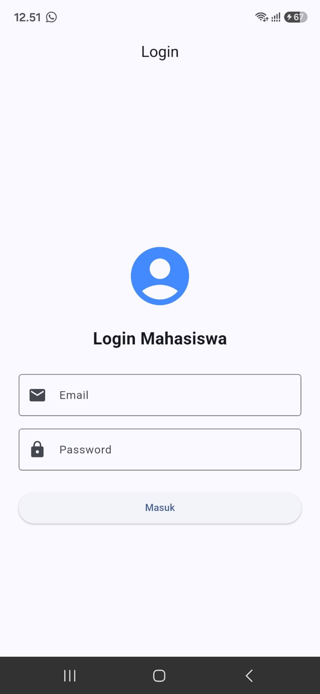
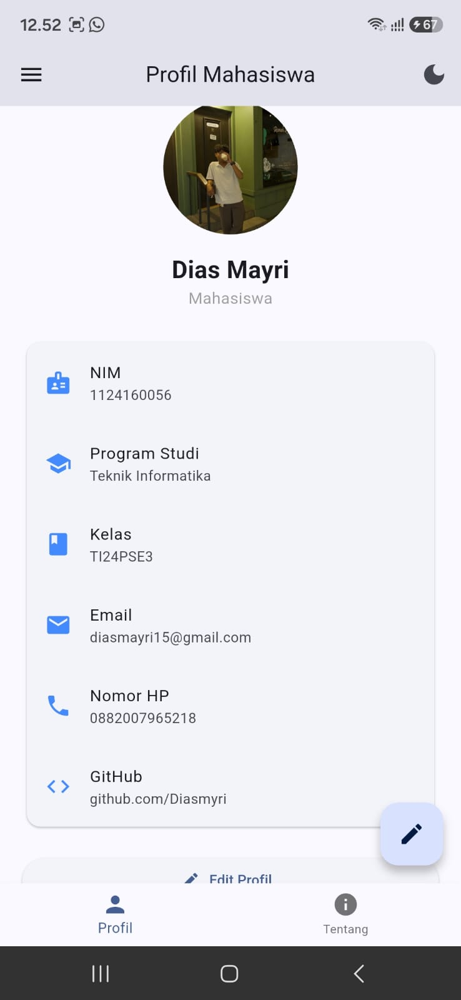
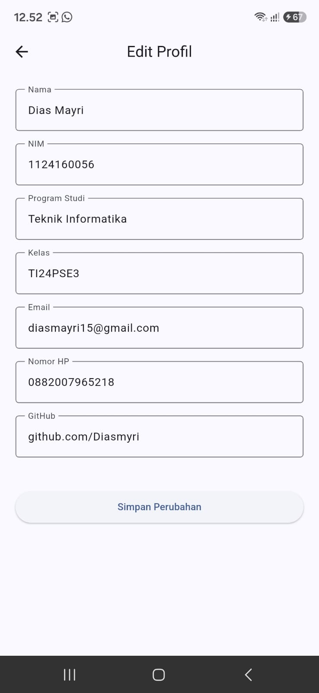
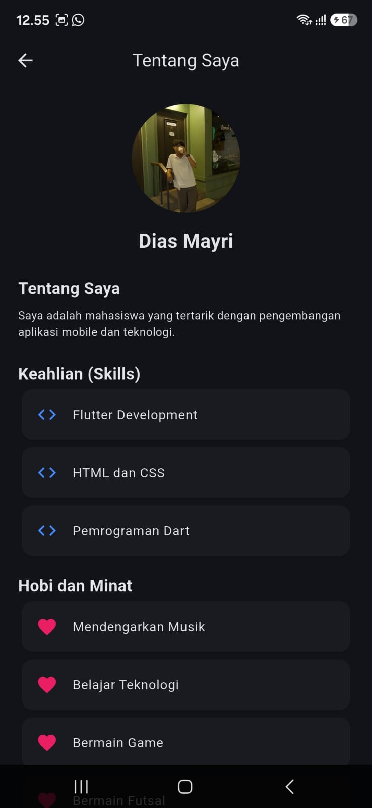

# Aplikasi Profil Mahasiswa

## Identitas

- **Nama:** Dias Mayri
- **NIM:** 1124160056
- **Program Studi:** Teknik Informatika
- **Kelas:** TI24PSE3
- **GitHub:** [Diasmyri](https://github.com/Diasmyri)

## Deskripsi

Aplikasi Profil Mahasiswa merupakan aplikasi mobile berbasis Flutter yang dibuat untuk memenuhi tugas Ujian Tengah Semester mata kuliah Aplikasi Mobile. Aplikasi ini menyediakan fitur login, melihat dan mengedit profil mahasiswa, serta menampilkan informasi tentang mahasiswa.

## Video Presentasi

Link YouTube: 

## Screenshot Aplikasi

### 1. Halaman Login



### 2. Halaman Profil



### 3. Halaman Edit Profil



### 4. Tampilan DarkMode



## Fitur Aplikasi

- Login dengan validasi email dan password.
- Menampilkan foto dan informasi profil mahasiswa.
- Mengedit informasi profil mahasiswa.
- Menampilkan halaman Tentang Saya.
- Menampilkan daftar keahlian dan riwayat pendidikan.
- Mengubah tema aplikasi Light Mode dan Dark Mode.
- Navigasi menggunakan Drawer dan BottomNavigationBar.
- FloatingActionButton untuk mengakses fitur edit profil.

## Teknologi

- Flutter
- Dart
- Material Design

## Cara Menjalankan Aplikasi

1. Clone repository:

   ```bash
   git clone https://github.com/Diasmyri/uts-pml-1124160056.git
   ```

2. Masuk ke folder project:

   ```bash
   cd uts-pml-1124160056/soal2_profil_app
   ```

3. Install dependencies:

   ```bash
   flutter pub get
   ```

4. Jalankan aplikasi:

   ```bash
   flutter run
   ```

## Download APK

APK Release versi `v1.0.0` dapat diunduh melalui bagian **Releases** pada repository GitHub.
